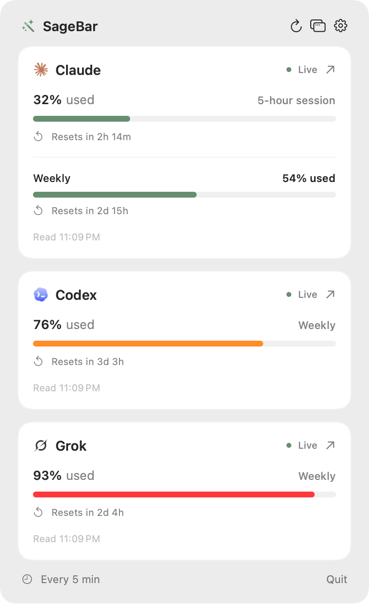

<div align="center">


# SageBar

**Claude, Codex, and Grok usage in your Mac’s menu bar.**

Free, open source, and native. No account, analytics, or servers.

[Download for macOS](https://github.com/thequietmind/sagebar/releases/latest) •
[sagebar.io](https://sagebar.io) •
[Report an Issue](https://github.com/thequietmind/sagebar/issues)

<p align="center">
  <picture>
    <source media="(prefers-color-scheme: dark)" srcset=".github/assets/screenshot-dark.png">
    <source media="(prefers-color-scheme: light)" srcset=".github/assets/screenshot-light.png">
    
  </picture>
</p>

</div>

---

SageBar keeps your AI plan limits in view. Each provider’s logo sits in the menu bar beside how much of its
current window you’ve used, and the dropdown shows every limit with its reset time.

## Features

- Claude session and weekly limits, Codex limits, and Grok’s weekly pool side by side
- Percentages or compact fill bars in the menu bar, optionally colored by usage
- Optional reset countdowns, such as `3d4h`
- Used or remaining capacity, whichever you prefer to watch
- A dropdown that pops out into a standalone window
- Sessions kept in the macOS Keychain and sent only to the provider they belong to
- A native Swift app with no dependencies, analytics, or SageBar account

## Install

Download the latest `SageBar-<version>.zip` from
[Releases](https://github.com/thequietmind/sagebar/releases/latest), unzip it, move SageBar to
Applications, and open it. Releases are signed with Developer ID and notarized by Apple. To start SageBar
when you log in, turn on **Launch at login** in Settings.

Requires macOS 14 or later on Apple silicon or Intel.

## Connect providers

Codex uses the installed CLI’s documented `account/rateLimits/read` interface and your existing sign-in. It
does not start a chat or spend model tokens. Supported CLI locations are Homebrew, `/usr/local/bin`,
`~/.local/bin`, and the Codex Desktop bundle. Each read starts a temporary app-server process, then stops it.

For Claude, open Settings and paste a `sessionKey` from claude.ai’s browser storage, or the Cookie request
header from its usage page.

Grok is off by default. Turn it on in Settings, then paste the whole Cookie request header from any grok.com
request, copied from your browser’s developer tools. SageBar reads the shared weekly pool that grok.com’s
Settings → Usage tab shows, from `grok.com/rest/grok/credits`; per-product shares are a breakdown of that
pool, not separate limits.

Saving a Claude or Grok session turns that provider on. Disconnect removes the saved session, and an
expired session needs to be replaced in Settings. Claude’s and Grok’s web usage endpoints are undocumented
and may change without notice.

## Reading the display

The menu bar shows each provider’s logo beside its percentage. Percentages mean **used** by default;
Settings can switch to remaining capacity. **Menu bar shows** can swap each percentage for a small fill bar
that follows the same used or remaining choice; the tooltip keeps the exact numbers. Bars are monochrome by
default; **Color bars by usage** fills them green below 70% used, yellow from 70%, and red from 90%, even
when showing remaining capacity. Choose which of Claude, Codex, and Grok appear in Settings. Disabled
providers disappear from the menu bar and dropdown and stop refreshing, but keep their saved connections.
At least one stays enabled.

Turn on **Show reset countdowns** to add a reset icon and compact time such as `3d4h` after each
percentage. With bars, the time sits beneath each bar instead, keeping the menu bar narrow. Countdowns are
off by default, use the same usage window as the percentage, and show `due` when a fresh reading is needed.

Each provider’s primary window appears in the menu bar. The dropdown names its actual duration (Codex’s
primary window is not always five hours) and shows any additional limits. Claude’s Fable weekly limit stays
hidden unless **Show Fable weekly limit** is on in Settings.

The window button beside Settings in the dropdown opens the same dashboard in a standalone window that stays
open while you work; SageBar remembers where you put it. Once popped out, clicking the menu bar item shows
and hides that window instead of the dropdown, bringing it forward if it’s covered or minimized. Closing the
window returns the menu bar item to the dropdown.

A dash means the current reading is unavailable or stale. The last successful readings stay in the
dropdown, marked, after a refresh error. A reset countdown reaching zero does not assume fresh quota; the
next read confirms it. Provider restrictions are shown separately from percentages.

## Privacy and security

Pasted sessions live only in your Mac’s Keychain. Each is sent only to its own site (`claude.ai` or
`grok.com`) over HTTPS; SageBar refuses redirects to other hosts and doesn’t log or store responses. Codex
handles its own credentials, and SageBar never reads Codex tokens. There’s no SageBar server, account, or
analytics. See [SECURITY.md](SECURITY.md) to report a vulnerability.

## Build from source

Install Xcode or the Xcode Command Line Tools, then:

```sh
git clone https://github.com/thequietmind/sagebar.git
cd sagebar
bash Scripts/build-app.sh
open build/SageBar.app
```

The build targets your Mac’s architecture; set `SAGEBAR_UNIVERSAL=1` for Apple silicon and Intel. Builds
are ad-hoc signed unless `SAGEBAR_SIGN_IDENTITY` names a certificate. Ad-hoc builds run fine on the Mac that
built them, but each rebuild looks like a new app to Keychain, which asks again for the saved sessions.
Signing with an Apple Development certificate keeps the identity stable so **Always Allow** sticks:

```sh
SAGEBAR_SIGN_IDENTITY="Apple Development" bash Scripts/build-app.sh
ditto build/SageBar.app /Applications/SageBar.app
```

## Development

```sh
swift build
swift test
swift run SageBar --check-codex
open build/SageBar.app --args --demo --preview
build/SageBar.app/Contents/MacOS/SageBar --render-screenshots "$PWD/build/screenshots"
```

`--check-codex` makes a live, read-only limit request and prints only percentages and reset descriptions.
`--demo` uses synthetic readings and makes no provider requests; settings changed in demo mode last until
it quits, and saved sessions and login items are left alone. `--preview` opens the dashboard window.

The app icon is built from `Assets/AppIcon.png`, a 1024 × 1024 PNG; replace it and rebuild to change the icon.

`--render-screenshots` writes the dropdown, Settings window, and every menu bar style in light and dark from
demo readings, at 2× (menu bar labels at 3×), for this README and the website. Settings draws as an inactive
window when macOS doesn’t let SageBar take focus. Copy `popup-light.png` and `popup-dark.png` to
`.github/assets/screenshot-light.png` and `screenshot-dark.png` after changing the dropdown.

Core parser tests cover both Claude response formats, Codex window durations, monthly credits,
restrictions, Grok credit periods and legacy billing, empty responses, reset boundaries, and session header
validation.

## Releasing

1. Set the new version in `VERSION`, then commit and tag it as `v<version>`.
2. Once, store notarization credentials, using an
   [app-specific password](https://support.apple.com/102654) when prompted:
   `xcrun notarytool store-credentials sagebar --apple-id <Apple ID> --team-id <team ID>`
3. Run `bash Scripts/release.sh`. It builds a universal app signed with your Developer ID Application
   certificate, notarizes and staples it, and prints the zip’s SHA-256.
4. Upload `build/SageBar-<version>.zip` to a GitHub release for the tag.

## Contributing

Issues, bug reports, and pull requests are welcome. Please keep changes focused, prefer native macOS
patterns, and run `swift test` before opening a pull request. New providers should read usage the way the
provider’s own app or website does, without spending tokens.

## License

MIT License. See [LICENSE](LICENSE).

The bundled Claude and Codex icons come from those apps’ monochrome menu bar assets, and the Grok icon is
rendered from the mark in grok.com’s logo. Claude, Codex, and Grok are trademarks of their respective
owners, used here to identify the services SageBar connects to. SageBar isn’t affiliated with Anthropic,
OpenAI, or xAI.

Protocol reference: [Codex App Server](https://learn.chatgpt.com/docs/app-server).
